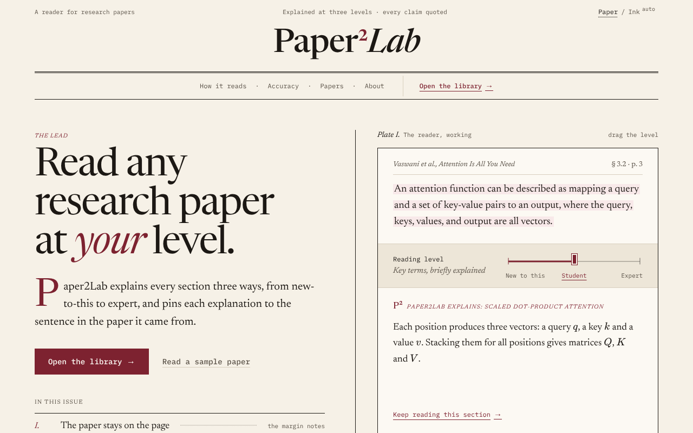
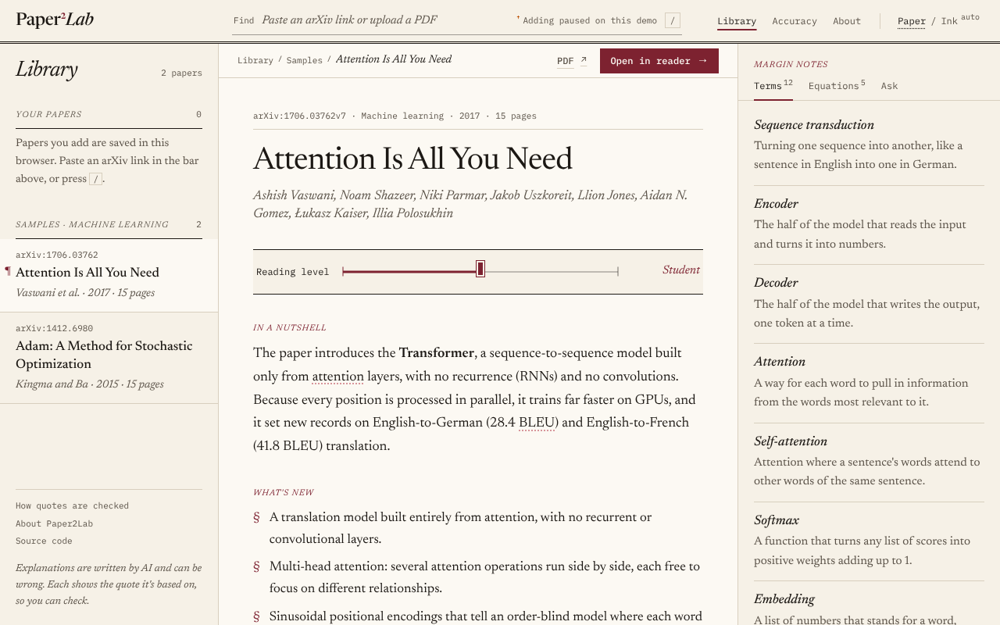
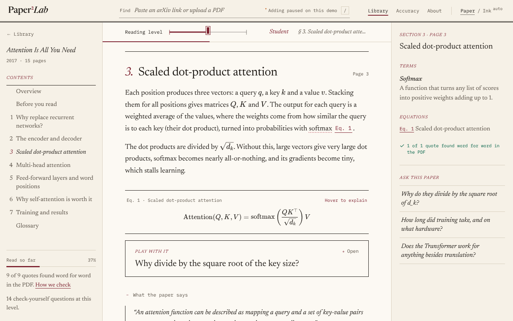
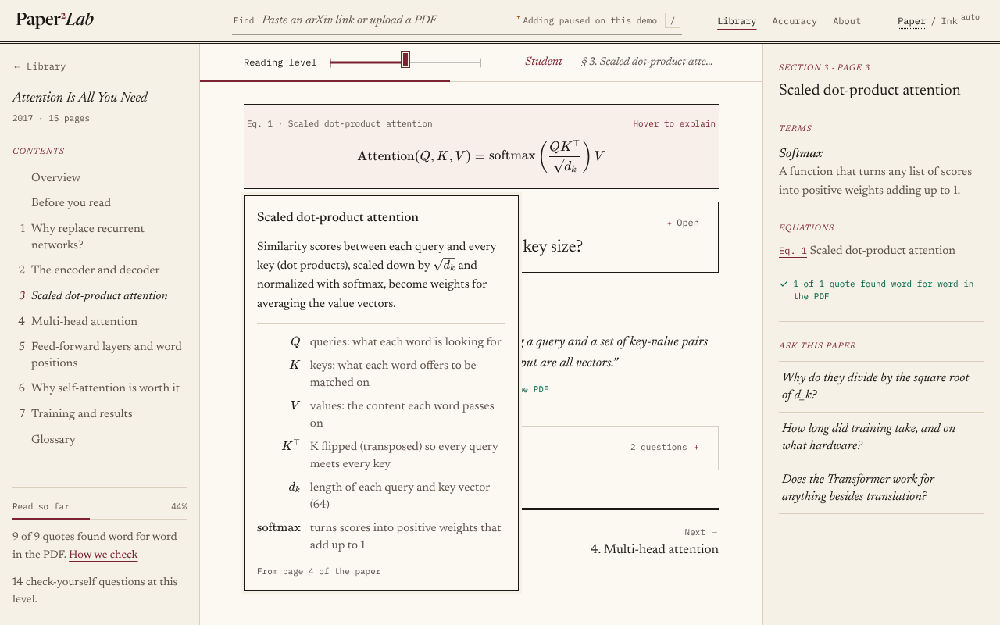
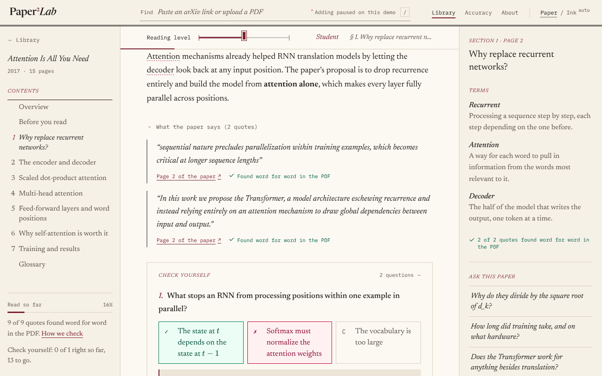
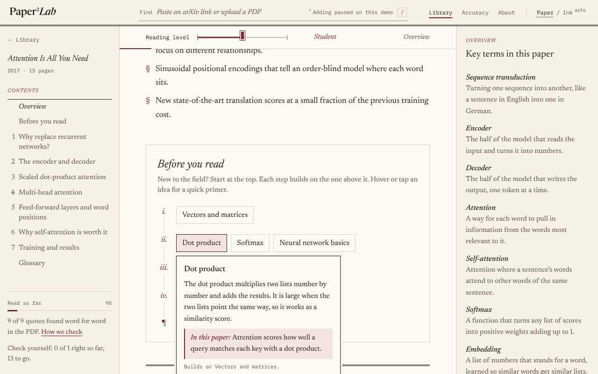
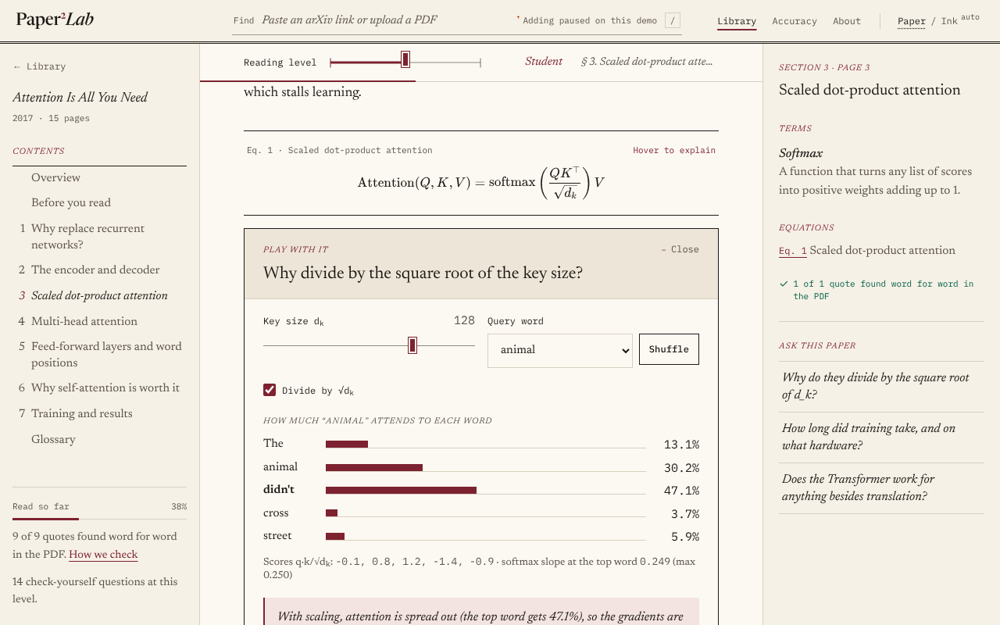
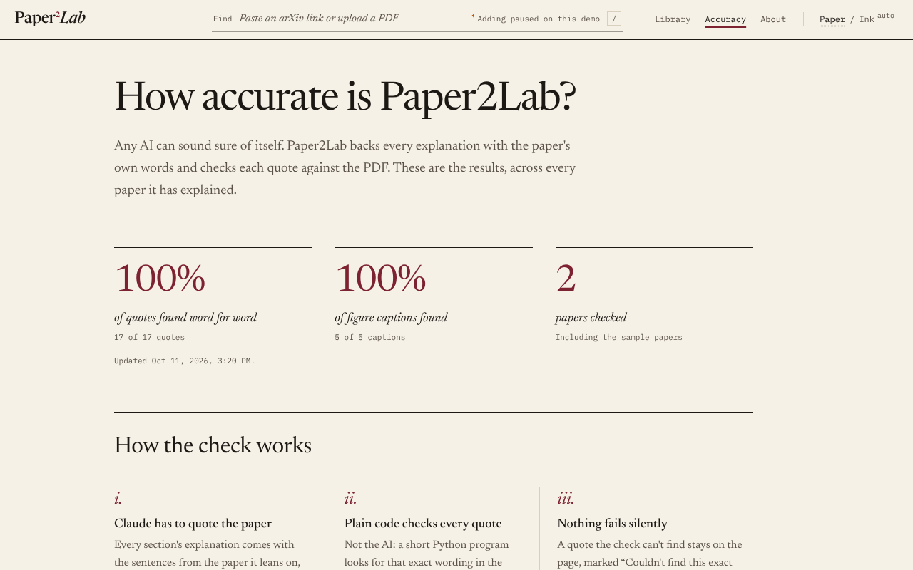
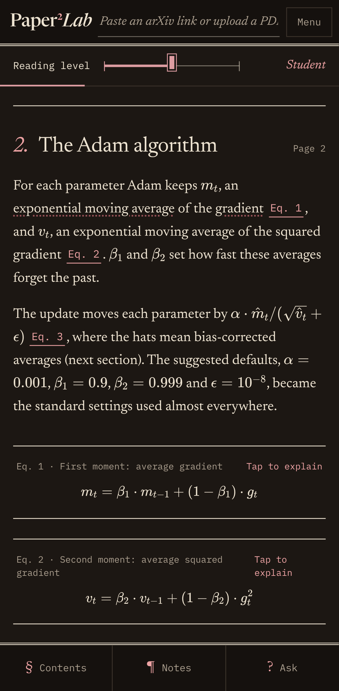
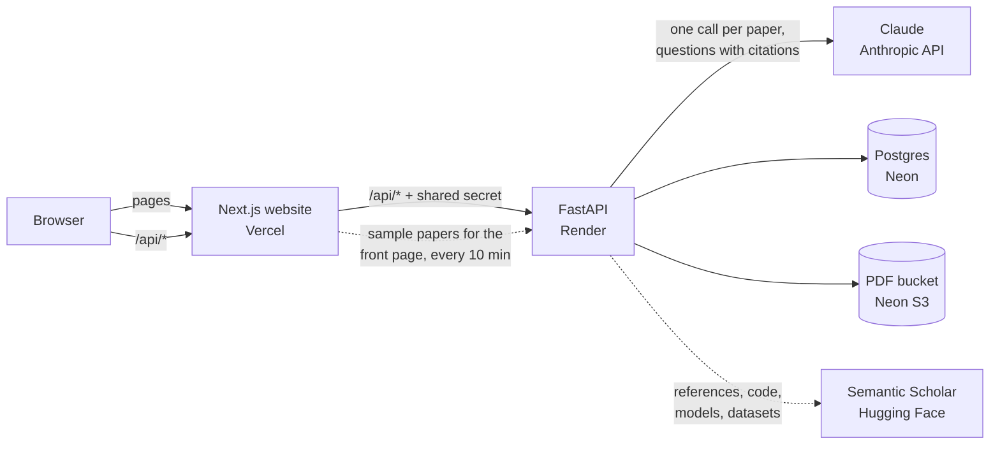

# Paper²Lab

**Live: [paper2lab-psi.vercel.app](https://paper2lab-psi.vercel.app)** · [Open the library](https://paper2lab-psi.vercel.app/library) · [Read a sample paper](https://paper2lab-psi.vercel.app/papers/00000000-0000-4000-8000-000000001706)

[](https://github.com/whatalshifa/paper2lab/actions/workflows/ci.yml)
[](LICENSE)

Read any research paper at your level. Add a PDF or an arXiv link, and Paper2Lab explains every
section three ways, from *new to this* to *expert*, says what each equation means symbol by symbol,
and pins every explanation to the sentence in the paper it came from, checked word for word against
the PDF by plain code, not by the AI.

> **Demo mode.** The AI runs only when an Anthropic API key is set. The live site has none, so it
> shows two papers explained in advance, *Attention Is All You Need* and *Adam*, and every feature
> works on them. Adding new papers and asking new questions is paused until a key is added. The API
> is on a free plan that sleeps when idle: pages say "waking up" and load by themselves, which can
> take up to a minute after a quiet spell.



## What it does

The site is set like a small journal: Newsreader for every word, IBM Plex Mono for controls and
labels, one claret ink, square corners, light "Paper" and dark "Ink" themes.

| Route | What's there |
|---|---|
| `/` | The front page: the pitch, a live reading-level demo on a real sample, the accuracy numbers, the sample shelf and two equation demos |
| `/library` | The app: your papers and the samples. On wide screens, three panes: the list, the selected paper's first page and its margin notes |
| `/papers/[id]` | The reader, one page at a time: overview, each section, what the paper connects to, glossary |
| `/accuracy` | How many quotes and figure captions were found word for word, across every paper, and how the check works |

| The library | The reader, at student level |
|---|---|
|  |  |
| **Every equation explained** | **Check yourself** |
|  |  |
| **What to know first** | **Push on the maths** |
|  |  |
| **Public accuracy page** | **On a phone, in Ink** |
|  |  |

- **Add a paper** from the command bar (press `/` anywhere): upload a PDF (up to 20 MB and 60 pages)
  or paste an arXiv link. The PDF is checked before any AI sees it.
- **One AI call per paper.** Claude reads the whole PDF and returns one structured answer: the
  sections, each explained at three levels, the key equations in LaTeX with every symbol explained,
  the figures and where they are, a glossary, what's new, and what to know first.
- **Reading-level slider.** *New to this*, *Student* and *Expert*. Every explanation, summary,
  equation and figure changes with it, and the choice is remembered on the device.
- **Every explanation shows its source.** Each section carries quotes from the paper with their page.
  Plain Python looks for each one in the PDF's own text; found quotes get a green tick, the rest are
  marked, so a made-up quote can't pass silently. Captions are checked the same way.
- **Equations, figures and terms explained in place.** Hover or tap an equation for its meaning and a
  table of symbols; figures are cut out of the PDF and explained; glossary terms are underlined.
- **Ask the paper.** Answers come from the paper alone, each sentence with numbered sources the
  Anthropic API's citations feature copied out of the PDF.
- **Prerequisite map, listen, quizzes and demos.** What to know first, laid out in steps; the
  explanation read aloud by the browser's own voice; check-yourself questions; and interactive demos
  beside key equations.
- **Your library, without an account.** Papers belong to your browser through a random key in a
  cookie scripts can't read; only its hash is stored.
- **Built to be shown.** Accessible (WCAG 2.1 AA, checked with axe in light and dark; full keyboard
  use; reduced motion respected), a strict content security policy, spending limits per browser,
  network and site, and calm "waking up" and "try again" states instead of errors.

## How it fits together



- The browser only talks to the website. Next.js forwards `/api/*` to FastAPI and adds a shared
  secret, so the API refuses anyone who tries to skip the website (and its spending limits).
- A paper is read in the background: queued, read by Claude in one call, then every quote and caption
  is checked against the PDF's text before it is shown.
- The front page is built with the sample papers already in it and refreshed every ten minutes, so it
  never waits for the API to wake. App pages fetch in the browser, keep trying while the API wakes,
  and say so.
- A scheduled GitHub Action ([`keep-warm.yml`](.github/workflows/keep-warm.yml)) keeps the API awake
  on weekdays during Indian working hours.

[docs/ARCHITECTURE.md](docs/ARCHITECTURE.md) walks through every part file by file, and
[docs/DECISIONS.md](docs/DECISIONS.md) explains the main choices.

## Tech stack

- **Website:** Next.js 16 (App Router), React 19, TypeScript, Tailwind CSS 4, KaTeX. On Vercel.
- **API:** Python 3.12, FastAPI, SQLAlchemy 2, Alembic, pdfplumber, Pydantic. On Render (Docker).
- **AI:** Claude through the Anthropic API: structured outputs, citations and prompt caching.
- **Data:** Postgres and an S3-compatible bucket on Neon; SQLite and a local folder on your computer.
- **Quality:** pytest, ruff, ESLint, Playwright with axe, GitHub Actions.

## Run it locally

You need Python 3.12+ and Node 22+. No API key is needed: without one the app runs in demo mode.

```bash
# 1. The API, on http://localhost:8000
cd backend
python -m venv .venv && source .venv/bin/activate
pip install -r requirements-dev.txt
cp .env.example .env          # add ANTHROPIC_API_KEY here to explain new papers
alembic upgrade head
uvicorn app.main:app --reload --port 8000

# 2. The website, on http://localhost:3000 (in a second terminal)
cd frontend
npm install
npm run dev
```

Open http://localhost:3000. The website forwards `/api/*` to `http://localhost:8000` unless
`API_URL` says otherwise (see `frontend/.env.example`). Or run everything, Postgres included, with
`docker compose up --build`.

## Testing

```bash
cd backend && ruff check . && ruff format --check . && pytest     # 88 tests
cd frontend && npm run lint && npm run build && npx playwright test  # 41 tests × desktop and phone
```

- **Backend (pytest):** a fake reader and answerer stand in for Claude, and small real PDFs are built
  in the tests. They cover uploads, the quote check, arXiv parsing (and refusing anything that isn't
  arXiv), privacy between browsers, spending limits, demo mode, retries, questions, figure cutting and
  the sample data.
- **Browser (Playwright):** the real website and API, in demo mode, in Chromium at desktop and phone
  sizes. They walk the main paths (front page to library to reader), check the slider, equations,
  quotes, quizzes, demos and accuracy page, run axe on every page in both themes, keep key pages within
  a height budget, and check what happens when the API is asleep or an address is wrong.
  `npx playwright test` starts both servers itself; run `npx playwright install chromium` once first.
- **CI** runs all of it on every push, applies the migrations to a real Postgres, and checks the
  sample quotes against the real PDFs on arXiv.

## Deploying

See [docs/DEPLOY.md](docs/DEPLOY.md): Render (API), Vercel (website) and Neon (database and PDF
bucket), all on free plans. To turn the AI on, add `ANTHROPIC_API_KEY` to the API's environment.

## License

MIT. See [LICENSE](LICENSE).
